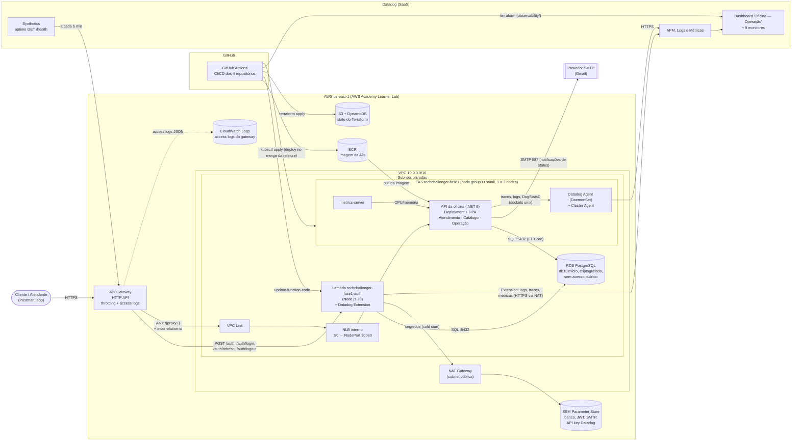

# Diagrama de componentes

Visão do sistema da oficina na AWS: borda (API Gateway), computação (EKS e Lambda), dados (RDS), segredos (SSM), entrega (GitHub Actions, ECR e Terraform) e monitoramento (Datadog).

## Visão geral

## Componentes

| Componente | Tecnologia | Responsabilidade | Repositório |
|---|---|---|---|
| **API Gateway** | Amazon API Gateway HTTP API (v2), stage `$default` | Porta de entrada única. Roteia `POST /auth*` para a Lambda e o resto (`ANY /{proxy+}`) para a API no EKS via VPC Link. Throttling global (50 req/s, burst 100) e mais restrito nas rotas de autenticação (5 req/s, burst 10). Access logs em JSON. Injeta `x-correlation-id = requestId` | TechChallenger-infra-kubernetes (`api-gateway.tf`) |
| **VPC Link + NLB interno** | API Gateway VPC Link, Network Load Balancer | Ligação privada do gateway com os nodes do EKS (NodePort 30080). A API não tem endereço público | TechChallenger-infra-kubernetes (`nlb.tf`) |
| **Lambda de autenticação** | AWS Lambda, Node.js 20, `pg`, `jsonwebtoken`, `bcryptjs` | Valida CPF, consulta existência e status do cliente, emite JWT (HS256) e refresh token. Login de `Adm`/`Funcionario` por e-mail e senha. Refresh com rotação e logout | TechChallenger-severless (código), TechChallenger-infra-kubernetes (`lambda.tf`) |
| **API da oficina** | ASP.NET Core 8, EF Core 8, DDD | Clientes, veículos, catálogo (serviços, peças, estoque) e ciclo da ordem de serviço. Valida o JWT em todas as rotas, exceto `/health` | TechChallenger-Api |
| **EKS** | Amazon EKS, node group gerenciado (1 a 3 nodes) | Executa a API com HPA, o metrics-server e o agente do Datadog | TechChallenger-infra-kubernetes (`eks.tf`), TechChallenger-Api (`k8s/aws/`) |
| **RDS** | Amazon RDS for PostgreSQL, `db.t3.micro`, gp3 20 a 50 GB | Banco relacional único da oficina, em subnets privadas, acessível só pelos SGs do EKS e da Lambda | TechChallenger-infra-database |
| **SSM Parameter Store** | SecureString / String | Credenciais do banco, segredo do JWT, SMTP e API key do Datadog. Lidos pela Lambda em tempo de execução e pelas pipelines no deploy | TechChallenger-infra-kubernetes (`ssm-parameters.yml`) |
| **ECR** | Amazon ECR | Imagens da API, com tag igual à versão da release | TechChallenger-infra-kubernetes (`ecr.tf`) |
| **Terraform state** | S3 (versionado, criptografado) + DynamoDB (lock) | State de cada repositório de infraestrutura, com key própria | TechChallenger-infra-kubernetes (`bootstrap/`) |
| **GitHub Actions** | Workflows por repositório | CI em todo PR; deploy da API e da Lambda no merge da release na `main`; apply/destroy da infraestrutura | todos |
| **Datadog** | Agent + Cluster Agent (Helm), Lambda Extension, Synthetics, Terraform provider | APM, logs, métricas de negócio (`oficina.*`), dashboard, monitores e uptime | TechChallenger-infra-kubernetes (`datadog.yml`, `observability/`) |
| **Provedor SMTP** | Gmail (senha de app) | Envio dos e-mails de mudança de status da OS | externo |

## Fronteiras de rede e segurança

- **Só o API Gateway é público.** A API está atrás de um NLB interno e o RDS não tem endereço público.
- **RDS:** a porta 5432 aceita conexões só do security group dos nodes do EKS e do SG da Lambda.
- **Saída para a internet** (SSM, Datadog, SMTP) passa pelo NAT Gateway.
- **Segredos** ficam no SSM e entram no cluster como Secret do Kubernetes no deploy. Nenhum segredo fica no repositório ou no state do Terraform.
- **IAM:** todos os componentes usam a `LabRole` existente, porque o Learner Lab não permite criar roles (ver [RFC-001](../rfc/RFC-001-escolha-da-nuvem.md)).

## Documentos relacionados

- [Diagramas de sequência](diagramas-de-sequencia.md): autenticação e abertura de ordem de serviço.
- [Modelo relacional](../banco-de-dados/modelo-relacional.md): banco, diagrama ER e relacionamentos.
- [ADR-003 do TechChallenger-infra-kubernetes](https://github.com/arthur-lucas-castro/TechChallenger-infra-kubernetes/blob/main/docs/adr/ADR-003-integracao-api-gateway-eks.md): por que VPC Link + NLB interno.
- [ADR-004 do TechChallenger-infra-kubernetes](https://github.com/arthur-lucas-castro/TechChallenger-infra-kubernetes/blob/main/docs/adr/ADR-004-observabilidade-datadog.md): estratégia de observabilidade.
