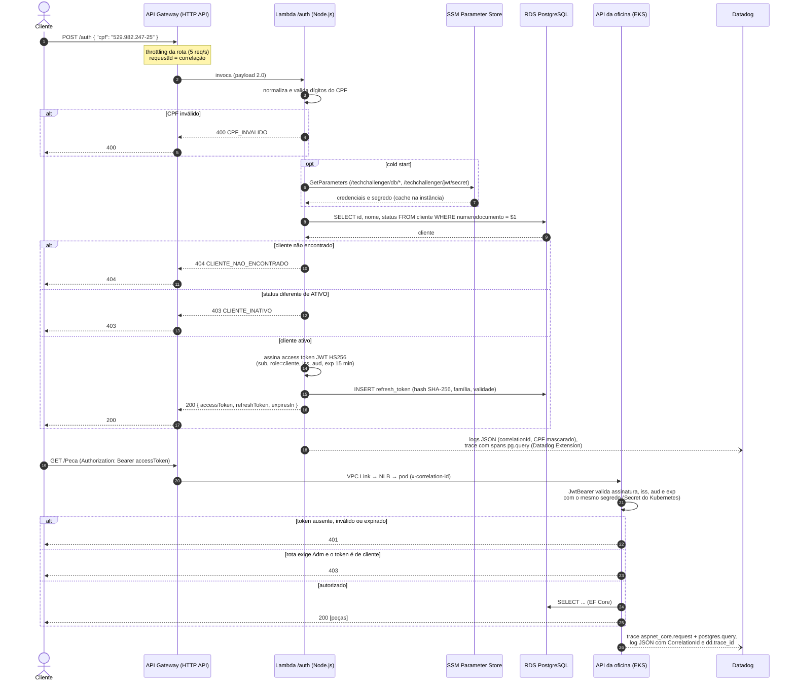
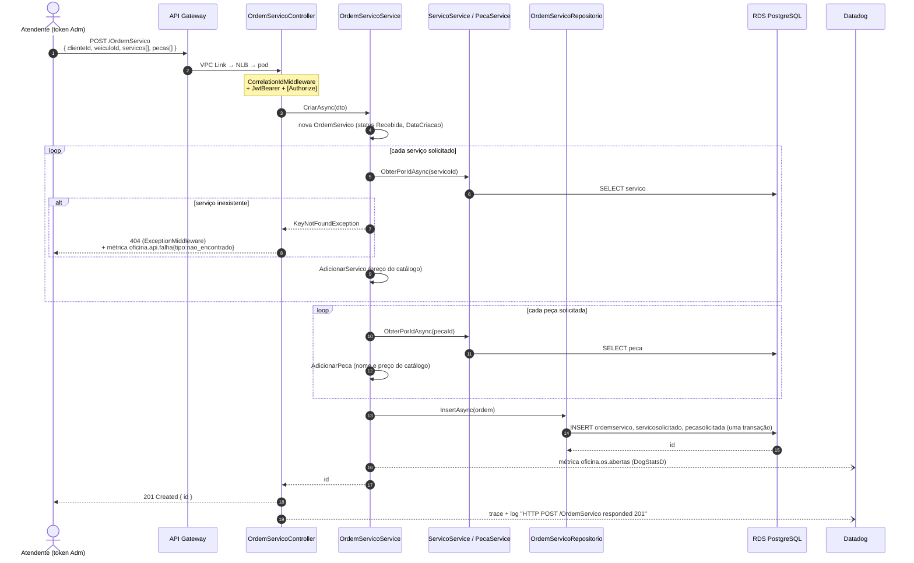
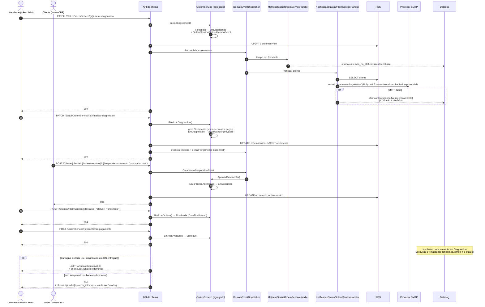
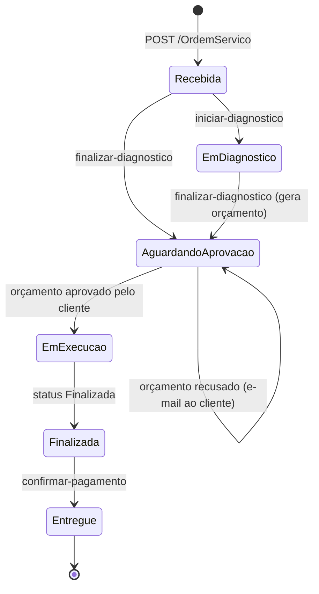

# Diagramas de sequência

Fluxos como estão implementados hoje. Todas as chamadas passam pelo API Gateway. O contrato completo da autenticação (campos, erros, tokens) está em [auth-flow.md do TechChallenger-severless](https://github.com/arthur-lucas-castro/TechChallenger-severless/blob/main/docs/auth-flow.md).

## 1. Autenticação do cliente por CPF e consumo de rota protegida

`Adm` e `Funcionario` seguem o mesmo caminho em `POST /auth/login`, com e-mail e senha (bcrypt) da tabela `usuario`. O token recebe `role=Adm` ou `role=Funcionario`, que a API usa em `[Authorize(Roles = "Adm")]`. Quando o access token expira, `POST /auth/refresh` troca o refresh token por um novo par (rotação); reusar um refresh token já trocado revoga toda a família (sessão).

## 2. Abertura da ordem de serviço

## 3. Ciclo da ordem de serviço até a entrega

Cada mudança de status gera o evento de domínio `OrdemServicoStatusAlteradoEvent`, despachado depois do commit. Os handlers rodam na mesma requisição ([ADR-005](../adr/ADR-005-padrao-de-comunicacao.md)).

## Estados da ordem de serviço

