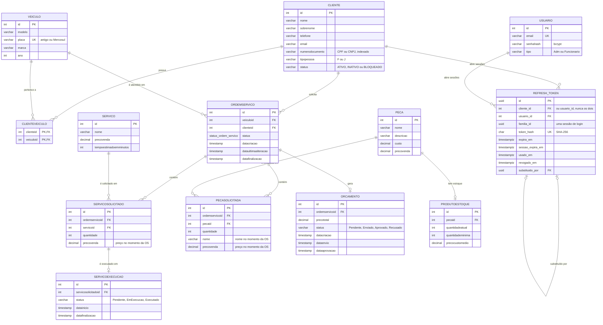

# Banco de dados: justificativa e modelo relacional

## 1. Escolha do banco

**Amazon RDS for PostgreSQL**, provisionado pelo [TechChallenger-infra-database](https://github.com/arthur-lucas-castro/TechChallenger-infra-database). A comparação com MySQL, SQL Server, Aurora e DynamoDB está na [RFC-002](../rfc/RFC-002-banco-de-dados.md). Em resumo:

| Necessidade do domínio | Como o PostgreSQL atende |
|---|---|
| A OS, os itens, o orçamento e a execução precisam mudar juntos | Transações ACID: um comando da API é um `SaveChanges` do EF Core, numa transação |
| Não pode existir item de OS sem OS, nem OS sem cliente e veículo | Chaves estrangeiras com integridade referencial |
| Status da OS limitado a valores conhecidos | Tipo `ENUM` nativo (`status_ordem_servico`) e `CHECK` em `cliente.status` |
| Relatórios por status, tempos de execução, histórico por cliente | Joins e agregações em SQL |
| Sessões de autenticação com ids não sequenciais e datas com fuso | Tipos `uuid` e `timestamptz` nativos |
| Mesmo banco usado por .NET e Node.js | Npgsql (EF Core) e `pg`, drivers maduros nas duas plataformas |
| Operação gerenciada, com backup e sem acesso público | RDS: backup de 7 dias, criptografia em repouso, subnets privadas |

## 2. Diagrama ER

Tabelas da API (`database/init/01_schema.sql`) e da autenticação (`db/migrations/V001` a `V003` do TechChallenger-severless). Os nomes ficam em minúsculas no banco (`UseLowerCaseNamingConvention`).

A tabela `auth_schema_migration (versao PK, aplicada_em)` só registra as migrations da Lambda já aplicadas e não se relaciona com as demais.

## 3. Relacionamentos

| Relacionamento | Cardinalidade | Implementação | Regra de negócio |
|---|---|---|---|
| Cliente ↔ Veículo | N:N | Tabela associativa `clienteveiculo`, chave composta | Um cliente pode ter vários veículos e um veículo pode trocar de dono ou ter mais de um responsável |
| Cliente → Ordem de serviço | 1:N | `ordemservico.clienteid` | Toda OS pertence a um cliente; é ele quem aprova o orçamento |
| Veículo → Ordem de serviço | 1:N | `ordemservico.veiculoid` | O histórico de manutenção do veículo é a lista das suas OS |
| Ordem de serviço → Serviço solicitado | 1:N | `servicosolicitado.ordemservicoid` | Itens do agregado `OrdemServico` |
| Serviço → Serviço solicitado | 1:N | `servicosolicitado.servicoid` | O catálogo define o serviço; o item guarda o preço da época |
| Ordem de serviço → Peça solicitada | 1:N | `pecasolicitada.ordemservicoid` | Itens do agregado `OrdemServico` |
| Peça → Peça solicitada | 1:N | `pecasolicitada.pecaid` | O item guarda nome e preço da época |
| Serviço solicitado → Execução | 1:0..1 | `servicoexecucao.servicosolicitadoid` | Criada quando o serviço começa a ser executado; registra início e fim |
| Ordem de serviço → Orçamento | 1:0..1 | `orcamento.ordemservicoid` | Gerado ao finalizar o diagnóstico; aprovado ou recusado pelo cliente |
| Peça → Estoque | 1:0..1 | `produtoestoque.pecaid` | Entidade interna do agregado `Peca`; baixa feita só pela peça |
| Cliente / Usuário → Refresh token | 1:N | `refresh_token.cliente_id` ou `usuario_id`, com `CHECK (num_nonnulls(cliente_id, usuario_id) = 1)` | Cada login abre uma família de tokens; a rotação liga um token ao seguinte por `substituido_por` |

**Agregados e fronteiras.** Os relacionamentos seguem os agregados do DDD: `OrdemServico` é dona de serviços e peças solicitados, execuções e orçamento; `Peca` é dona do estoque; `Cliente` e `Veiculo` são agregados separados, referenciados por id. A exclusão em cascata (`ON DELETE CASCADE`) acompanha essas fronteiras: apagar uma OS apaga os itens dela.

**Desnormalização intencional.** `servicosolicitado.precovenda`, `pecasolicitada.nome` e `pecasolicitada.precovenda` copiam valores do catálogo. É de propósito: a OS e o orçamento precisam continuar com o preço combinado mesmo que o catálogo mude depois.

## 4. Ajustes feitos no modelo na Fase 3

| Ajuste | Onde | Motivo |
|---|---|---|
| Coluna `cliente.status` (`ATIVO`, `INATIVO`, `BLOQUEADO`) com `CHECK` e valor padrão `ATIVO` | Migration `V001` (TechChallenger-severless) | A autenticação por CPF precisa consultar a situação do cliente. O valor padrão mantém compatíveis os `INSERT`s da API, que não conhece a coluna |
| Índice `ix_cliente_numerodocumento` | `V001` | Cada `POST /auth` busca o cliente pelo CPF; sem índice seria varredura da tabela |
| Tabela `usuario` (e-mail único, senha em bcrypt, tipo) | `01_schema.sql` | Login de `Adm` e `Funcionario` por e-mail e senha, com papéis usados no `[Authorize(Roles)]` |
| Tabela `refresh_token`, com índices por família, cliente e usuário | `V002` e `V003` | Sessões com rotação e detecção de reuso. Só o hash SHA-256 do token é guardado. O `CHECK` garante que cada token tem exatamente um dono (cliente ou usuário) |
| Tabela `auth_schema_migration` | `V001` | Controle das migrations da Lambda; todas são idempotentes e podem rodar de novo |
| `dataultimaalteracao` atualizada a cada transição | Entidade `OrdemServico` | Base da métrica de tempo médio por status do dashboard |
